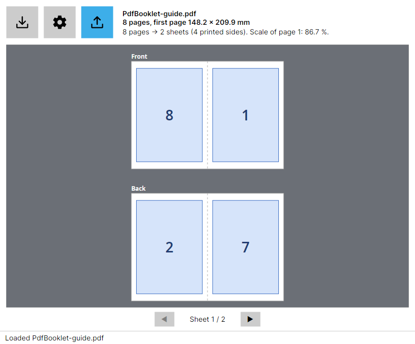
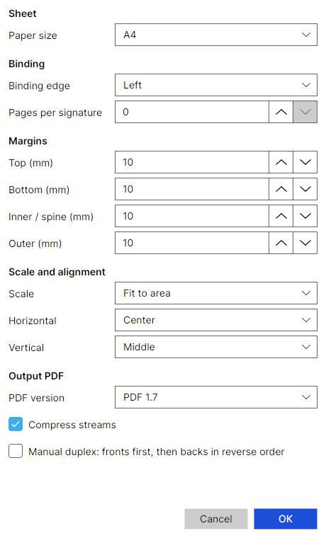

# PdfBooklet

Turn any PDF into a print-ready 2-up booklet. PdfBooklet puts two pages on each side of a sheet, in the order that makes them read correctly once the stack is folded in the middle. Built with .NET 10 and Avalonia UI, for Windows, Linux and macOS.



Open a PDF with the first button, adjust the layout with the second (gear) and export with the third. The preview shows exactly what will be exported.

## Features

- Live preview of the front and back of every sheet; blank padding pages are shown dashed
- Sheet sizes A3, A4, A5, Letter, Legal, Tabloid or a custom size (50–2000 mm). Sheets are always landscape, two pages side by side
- Binding on the left or the right (right-to-left books)
- Signatures: split a long document into separately folded groups of a multiple of 4 pages, or fold it as one
- Four margins: top, bottom, inner (to the fold) and outer (to the sheet edge)
- Scale: fit to the area, actual size or a custom percentage; horizontal (inner, center, outer) and vertical (top, middle, bottom) alignment
- Output PDF version 1.4–1.7 and stream compression
- **Manual duplex** for single-sided printers: all fronts first, then all backs in reverse order
- Settings are remembered between runs; the original file is never modified and never overwritten
- Optional file argument: `pdfbooklet file.pdf` opens it at startup

## Install

Download the installer for your system from the [Releases](https://github.com/fuszenecker/PdfBooklet/releases) page.

| System | File | Install |
|---|---|---|
| Debian, Ubuntu | `pdfbooklet_<version>_amd64.deb` | `sudo apt install ./pdfbooklet_<version>_amd64.deb` |
| Fedora, RHEL, Rocky | `pdfbooklet-<version>-1.el10.x86_64.rpm` | `sudo dnf install ./pdfbooklet-<version>-1.el10.x86_64.rpm` |
| Windows (x64) | `PdfBooklet-<version>-win-x64-setup.exe` | Run the installer. SmartScreen may warn because it is unsigned: More info, then Run anyway |
| macOS (Apple Silicon) | `PdfBooklet-<version>-osx-arm64.dmg` | Drag the app to Applications. It is only ad-hoc signed: on first launch use right-click, then Open |

The programs are self-contained; no .NET installation is needed.

## Using it

1. **Import** a PDF. PdfBooklet reads the page sizes and shows the layout.
2. **Settings** (gear): choose paper, binding, margins, scale, alignment and output options, then press OK. Settings that cannot work (negative margins, no room left on the sheet, a signature size that is not a multiple of 4) show the reason and disable OK.
3. **Export** the booklet PDF and print it.



### Printing

- **Duplex printer:** print the exported PDF as it is, double-sided, *flip on short edge*, at 100 % (not "fit to page"), with the paper size you chose.
- **Single-sided printer:** tick *Manual duplex* before exporting. Print the first half of the pages, turn the whole stack over around its short edge, put it back in the tray and print the second half. For a 10-page output that is pages 1–5, then 6–10, which are the duplex pages 1, 3, 5, 7, 9 followed by 10, 8, 6, 4, 2. How the stack must be loaded depends on the printer, so test with the sample first (two sheets).

### Sample and user guide

[`docs/PdfBooklet-guide.pdf`](docs/PdfBooklet-guide.pdf) is an 8-page user guide that is also the sample PDF: 8 pages make exactly two sheets, with no blank pages. Import it, check the preview against the checklist on its last page, export it and print it.

To regenerate it (needs Python, `pip install reportlab` and the DejaVu fonts in `/usr/share/fonts/truetype/dejavu`):

```bash
python3 docs/make-guide.py
```

## Configuration

Defaults are in the bundled `appsettings.json`; your changes are saved on top of it in a per-user file:

- Windows: `%LocalAppData%\PdfBooklet\appsettings.json` (`%AppData%\PdfBooklet` is also read)
- Linux: `$XDG_CONFIG_HOME/PdfBooklet/appsettings.json`, or `~/.config/PdfBooklet/appsettings.json`
- macOS: `~/Library/Application Support/PdfBooklet/appsettings.json`

## Building and testing

Requires the [.NET 10 SDK](https://dotnet.microsoft.com/download/dotnet/10.0).

```bash
dotnet build src/PdfBooklet.csproj
dotnet test tests/PdfBooklet.Tests/PdfBooklet.Tests.csproj
dotnet run --project src/PdfBooklet.csproj -- path/to/file.pdf
```

## Packaging and releases

The scripts in `scripts/` build the installers and read the version from `version.txt`; outputs go to `installer/`.

| Platform | Script | Needs |
|---|---|---|
| Debian package | `scripts/Build-Deb-Installer.sh` | `dpkg-deb` |
| RPM package | `scripts/Build-Rpm-Installer.sh` | `rpmbuild` |
| Both Linux packages in containers | `scripts/Build-Installer.Podman.sh` | `podman` only |
| Windows installer | `scripts/Build-Installer.ps1` | [NSIS](https://nsis.sourceforge.io/) |
| macOS disk image | `scripts/Build-Dmg-Installer.sh` | macOS |

Pushing a tag (for example `1.0.0.0`) runs the `Release` workflow: it runs the tests, builds all four installers and publishes them as a GitHub release. Keep the tag equal to `version.txt`.

## Project structure

```
src/        Views, ViewModels, Services, Stores, Interfaces, Models, Configuration, Composition
tests/      PdfBooklet.Tests (MSTest + NSubstitute)
docs/       User guide and sample PDF (PdfBooklet-guide.pdf), its generator and screenshots
scripts/    Installer build scripts
container/  Containerfiles for the Linux package builds
installer/  NSIS script and package output
```

The architecture and conventions are described in [AGENTS.md](AGENTS.md).

## License

PdfBooklet is free software under the [GNU Affero General Public License v3.0](LICENSE). It uses [PDFsharp](https://github.com/empira/PDFsharp) under its AGPL terms and [Avalonia](https://avaloniaui.net/) under the MIT license.
